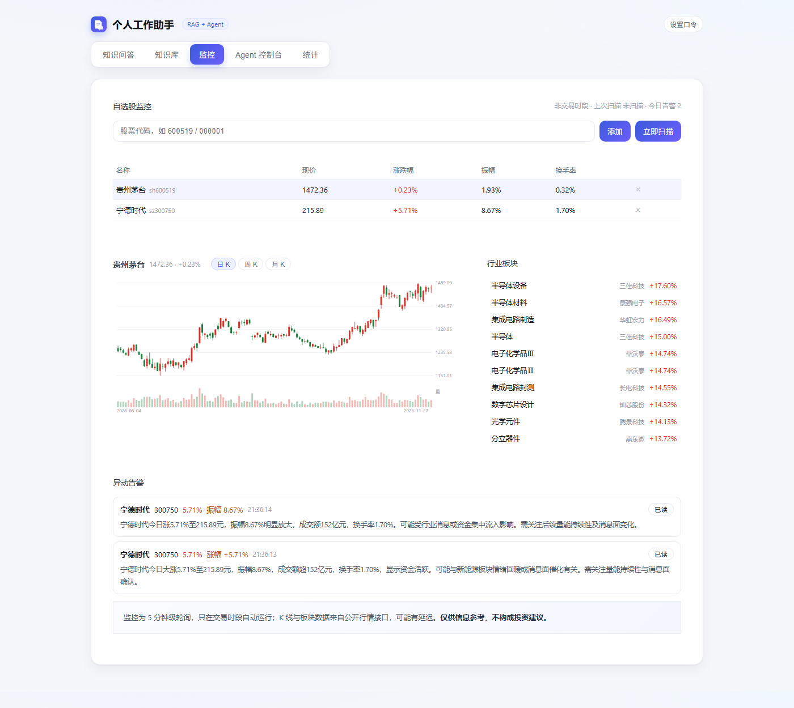

# 个人知识助手

<p align="center"></p>

面向金融场景的 AI 助手：合规问答、行情监控与金融计算。在线 Demo：https://earn-all-you-want.up.railway.app

支持带引用的文档问答、多步任务的 Agent、多会话记录和用量统计。


## 功能

- **文档问答**：向量检索 top-5 片段，模型依据片段回答并标注引用编号；没有相关资料时拒答
- **流式输出**：SSE 逐字返回，前端边收边显示
- **Agent**：10 个工具（检索、四则、numpy、读写文件、列目录、联网搜索/抓网页、金融计算、行情），模型自行决定调用顺序，最多 6 步
- **金融计算 Agent**：复利、等额本息/本金贷款、NPV、IRR、CAGR、持仓盈亏 6 类计算，直接调用并给出过程
- **Agent 流式与审批**：SSE 实时推送每轮工具调用；写文件前必须人工确认；同一会话带多轮记忆
- **会话管理**：新建、切换、删除会话，历史消息持久化
- **用量统计**：问答次数、token、成本、平均延迟，按天聚合
- **检索模式**：质量（top-20 + LLM rerank）与速度（向量 top-5）可切换；多轮追问自动改写查询
- **多知识库**：支持新建知识库、上传 Markdown / TXT / PDF，按库隔离检索；**默认检索全部库**，也可选择单个库缩小范围
- **自选股监控**：自选股行情 + 日/周/月 K 线 + 行业板块涨幅榜与领涨个股；交易时段每 5 分钟轮询，规则触发后调用模型写解读并生成告警
- **联网检索**：问答可选「联网」，先搜索再抓网页正文回答，来源显示为链接；Agent 新增 `web_search` / `fetch_url` 两个工具
- **MCP Server**：把检索与计算封装为 MCP 工具，Claude Desktop / Cursor 等客户端可直接调用

## 知识库

目前有两个示例库：

- **FastAPI 官方文档**：158 篇 Markdown，剔除元信息后 138 个文件、1326 块，向量约 14MB
- **金融合规**：证券法、上市公司信息披露管理办法、证券期货投资者适当性管理办法 3 篇 PDF，按「第 X 条」切块 **351 块**；15 题评测 15/15，其中 5 道投资建议/超范围问题全部拒答

上传 PDF 时会做中文排版清洗（合并单字换行、去掉汉字间空格），再按条文切成小节，保证一块对应一条法规。

重建 FastAPI 索引：

```powershell
python ingest_docs.py --dry-run   # 先看切块数量
python ingest_docs.py             # 调用 embedding 生成 vectors.json
```

脚本会处理 frontmatter、`{!...!}` 引用、`///` 指令和代码块；支持断点续传，超过 8192 token 的块会被跳过。

如果换成自己的文档，把 Markdown 放进 `build/docs/`，用 `python step8_embed.py` 重建即可（那套脚本按字符切块）。

## MCP

项目提供 MCP Server（`build/mcp_server.py`），暴露两个工具：

| 工具 | 说明 |
|---|---|
| `search_docs` | 在 FastAPI 文档库中检索，返回段落与来源文件 |
| `calculator` | 四则运算与乘方，表达式用 AST 白名单校验 |

在支持 MCP 的客户端（Claude Desktop、Cursor 等）中配置：

```json
{
  "mcpServers": {
    "fastapi-docs": {
      "command": "python",
      "args": ["C:/path/to/ai-journey/build/mcp_server.py"]
    }
  }
}
```

命令行验证：`python mcp_client_demo.py`（列出工具并各调用一次）。

### Agent 消费外部 MCP 工具

除了作为 Server，Agent 也能反向接入外部 MCP Server。在 `build/mcp_servers.json` 中配置：

```json
{
  "servers": [
    {"name": "time", "command": "python", "args": ["-m", "mcp_server_time"]}
  ]
}
```

启动时自动发现这些 server 的工具，把 `input_schema` 转成模型可用的 function 格式，与本地 10 个工具合并；调用时通过 stdio 转发。

实测：接入官方 `mcp-server-time` 后，问「把北京时间 14:30 转换成纽约时间」，Agent 自动调用 `convert_time(source_timezone, target_timezone, time)` 并给出 01:30 的结论。

> 注意：mcp 2.x 的工具描述字段是 `input_schema`（下划线），1.x 是 `inputSchema`；字段名读错会导致参数 schema 为空、模型只能猜参数名。桥接层对两种写法都做了兼容。

依赖：`pip install mcp mcp-server-time`。MCP 相关代码单独运行，不影响主应用镜像。

## 部署

### 本机 Docker

```powershell
docker compose up -d --build
```

### 公网部署（Railway）

1. 把仓库推到 GitHub
2. Railway → New Project → Deploy from GitHub repo
3. 在 Variables 里填入 `.env.example` 中的变量（`LLM_API_KEY`、`BAILIAN_API_KEY` 必填）
4. Settings → Networking → Generate Domain
5. 健康检查路径 `/health`，`railway.json` 已配置

说明：

- 向量索引 `build/vectors.json`（约 14MB）随镜像打包，部署时不需要重建索引
- SQLite 默认写在容器内，重启后清空；要持久化就挂载卷并设置 `ASSISTANT_DB`
- 上传的文档和向量默认存在容器内 `data/kbs`，**容器重启会清空**；要持久化就挂载卷并设置 `KB_DIR`

**Railway 挂卷步骤**（卷没有独立标签页）：

1. 项目页按 `Ctrl+K`（Mac `⌘K`）→ 输入 `volume` → Create Volume；或右键点项目画布
2. 选择要挂的服务，Mount path 填 `/data`
3. 在 Variables 里加：

```
ASSISTANT_DB=/data/assistant.db
KB_DIR=/data/kbs
AGENT_WORKSPACE=/data/agent_workspace
```

4. 重新部署后，上传的文档在后续部署中保留
- 云平台会注入 `PORT`，Dockerfile 的启动命令已支持
- **公开部署建议设置 `ACCESS_TOKEN` 与 `RATE_LIMIT_PER_MIN`**：设置后接口要求请求头 `X-Access-Token`，并按 IP 每分钟限流；前端右上角「设置口令」输入一次即可

## 可观测与测试

- 每个请求分配 trace_id，响应头 `X-Request-Id` 回传，日志可串联
- `/metrics` 暴露 Prometheus 文本：请求数、5xx、平均延迟、问答次数、token、成本、知识库数
- 单元测试：`python -m pytest build/tests -q`（沙箱、切块、限流、口令、API 冒烟，不调用外部模型）
- GitHub Actions：push 自动跑后端测试 + 前端构建

## 联网

问答页的「联网」开关会绕过本地知识库，改用网页结果回答：

1. 搜索：优先 `TAVILY_API_KEY`；没配就用 DuckDuckGo，再回退 Bing
2. 抓取前 2 个网页正文（每页最多 1800 字）作为资料
3. 回答仍带 [编号]，来源显示为可点击链接
4. Agent 也新增 `web_search` 和 `fetch_url` 两个工具

安全与限制：

- 抓取只允许 http/https，禁止私网、回环、链路本地地址（SSRF 防护）
- 单页最多读 2MB、15 秒超时；不支持的 Content-Type 直接拒绝
- 联网每题多 5–15 秒；搜索引擎可能限流或改版，失败时回退本地知识库

## 监控

自选股异动监控，定位是**信息聚合与解释**，不是交易信号：

1. 交易时段（周一至周五 9:30–11:30、13:00–15:00）每 5 分钟拉一次行情
2. 规则：涨跌幅 ≥ 3%、振幅 ≥ 5%、换手率 ≥ 5%
3. 命中后调用模型生成 80 字解读，写入告警表
4. 同一股票同一规则 30 分钟内不重复告警，单次扫描最多 5 条
5. 前端：自选股行情表 + 日/周/月 K 线（蜡烛图 + 成交量）+ 行业板块涨幅榜，点板块看领涨个股
6. 告警时间线，支持标记已读



行情接口免 key，但为非官方接口；页面明确标注「不构成投资建议」。

## 技术栈

| 层 | 选型 |
|---|---|
| 后端 | Python 3.11、FastAPI、SQLite |
| 前端 | React 18、Vite |
| 生成模型 | DeepSeek `deepseek-flash` |
| 向量模型 | 阿里云百炼 `text-embedding-v3`（1024 维） |

## 目录结构

```
build/
├── app.py               FastAPI 应用（问答 / Agent / 知识库 / 监控）
├── llm.py               模型调用与成本计算
├── store.py             会话与用量存储
├── ingest_docs.py       FastAPI 文档接入与切块
├── kb_index.py          多知识库索引与检索
├── kb_store.py          知识库元数据
├── step2_chunks.py      基础切块（被 step8 复用）
├── step3_retrieve.py    关键词检索（评测对比用）
├── step8_embed.py       embedding 调用
├── step9_vector.py      向量检索 / 翻译 / 融合
├── rerank.py            LLM 重排
├── query_rewrite.py     多轮查询改写
├── step13_agent.py      Agent 循环与工具定义
├── agent_runs.py        流式执行与写操作审批
├── numpy_tool.py        numpy 计算工具（AST 白名单）
├── mcp_server.py        MCP 服务（search_docs / calculator）
├── mcp_bridge.py        MCP 客户端桥接
├── market.py            行情抓取与解析
├── monitor.py           异动规则与调度
├── watch_store.py       自选股与告警存储
├── step14_task_eval.py  Agent 任务评测
├── eval_*.py            检索 / 改写 / 金融 / 知识库评测脚本
├── tests/               单元测试
├── docs/                示例文档
├── eval/                评测集
└── vectors.json         向量索引
```

前端：

```
frontend/
├── src/api.js           接口封装（含 SSE 解析）
├── src/App.jsx          全局状态与标签页
├── src/views/           问答 / 知识库 / 监控 / Agent / 统计
└── vite.config.js       开发代理配置
```

## 快速开始

### 环境要求

- Python 3.10+
- Node.js 18+

### 配置

在仓库根目录创建 `.env`：

```ini
LLM_BASE_URL=https://api.deepseek.com
LLM_API_KEY=sk-xxx
LLM_MODEL=deepseek-flash
PRICE_IN=0.15
PRICE_OUT=0.6

BAILIAN_API_KEY=sk-xxx
BAILIAN_BASE_URL=https://dashscope.aliyuncs.com/compatible-mode/v1
EMBED_MODEL=text-embedding-v3
```

### 启动

方式一：一键启动（会自动构建前端并托管，单端口）

```powershell
powershell -ExecutionPolicy Bypass -File .\start.ps1
```

访问 http://127.0.0.1:8000，接口文档 http://127.0.0.1:8000/docs。

方式二：Docker

```powershell
docker compose up -d --build    # 构建并后台启动
docker compose logs -f          # 查看日志
docker compose down             # 停止
```

镜像为多阶段构建：Node 编译前端 → Python 运行时托管 API 和静态页面。
数据库和 Agent 生成的文件挂载在 `./data`，删除容器不会丢数据；`.env` 通过 `env_file` 注入，不打包进镜像。

国内网络拉取基础镜像较慢，可在 Docker Desktop → Settings → Docker Engine 中配置 `registry-mirrors`。

方式三：开发模式（前后端分离，支持热更新）

```powershell
# 终端 1
cd build
python app.py

# 终端 2
cd frontend
npm install
npm run dev
```

访问 http://localhost:5173，`/api` 由 Vite 代理到 8000。

### 重建索引

FastAPI 文档：`python ingest_docs.py`（见上文「知识库」）。

`build/docs/` 下的自有文档：

```powershell
python step8_embed.py
```

## API

| 方法 | 路径 | 说明 |
|---|---|---|
| POST | `/ask` | 问答，可带 `session_id` |
| POST | `/ask/stream` | 流式问答（SSE） |
| POST | `/agent/run` | 执行 Agent 任务（一次性返回） |
| POST | `/agent/stream` | 执行 Agent 任务（SSE 推工具轨迹，写文件前等待审批） |
| POST | `/agent/approve` | 批准或拒绝挂起的写操作 |
| POST | `/sessions` | 新建会话 |
| GET | `/sessions` | 会话列表 |
| GET | `/sessions/{id}` | 会话消息 |
| DELETE | `/sessions/{id}` | 删除会话 |
| GET | `/kbs` | 知识库列表 |
| POST | `/kbs` | 新建知识库 |
| GET | `/kbs/{id}` | 知识库详情（含文档列表） |
| PATCH | `/kbs/{id}` | 重命名知识库 |
| DELETE | `/kbs/{id}` | 删除知识库 |
| POST | `/kbs/{id}/documents` | 上传文档（md / txt / pdf） |
| GET | `/watchlist` | 自选股列表（含实时行情） |
| POST | `/watchlist` | 添加自选股 |
| DELETE | `/watchlist/{symbol}` | 删除自选股 |
| GET | `/alerts` | 异动告警列表 |
| POST | `/alerts/{id}/ack` | 标记告警已读 |
| POST | `/monitor/scan` | 手动触发一次扫描 |
| GET | `/monitor/status` | 监控状态（交易时段、上次扫描） |
| GET | `/kline` | 日/周/月 K 线（前复权） |
| GET | `/sectors` | 行业板块涨幅榜 |
| GET | `/sectors/{code}/stocks` | 板块领涨个股 |

`/ask` 与 `/ask/stream` 额外支持 `web: true`，开启联网检索。
| GET | `/stats` | 汇总统计 |
| GET | `/metrics` | Prometheus 指标 |
| GET | `/stats/daily?days=7` | 按天统计 |
| GET | `/health` | 健康检查 |

前端请求统一带 `/api` 前缀，后端中间件负责剥离；开发环境由 Vite 代理，生产环境由同一服务处理。

## 评测

早期的检索对比实验在 3 篇示例文档上完成（共 9 块，评测集 20 题，存档于 `eval/legacy_demo/`）：

| 检索方式 | 阈值 | top-k | 准确率 |
|---|---|---|---|
| 关键词 | 0.1 | 3 | 70% |
| 关键词 + 查询改写 | 0.1 | 3 | 75% |
| 向量 | 0.45 | 3 | 80% |
| 向量 | 0.45 | 5 | 90% |

换成 FastAPI 文档后的检索评测（20 题，每题标注应命中的源文件，`python eval_retrieval.py`）：

| 方案 | recall@1 | recall@5 | 检索耗时 |
|---|---|---|---|
| 向量检索 | 85% | 95% | 0.65s |
| 向量 + 中文问题翻译成英文 | 75% | **100%** | 2.2s |

翻译会降低 top-1 精度，但产品把 top-5 交给模型挑选，所以按 recall@5 取舍：**中文提问走翻译，英文提问直接检索**（代码里按是否包含汉字判断）。

检索模式对比（20 题，`python eval_modes.py`）：

| 方案 | hit@1 | hit@5 | MRR |
|---|---|---|---|
| speed：向量 top-5 | 70% | 95% | 0.817 |
| quality：top-20 + LLM rerank | **90%** | **100%** | **0.935** |

quality 模式每题多约 1–2 秒，换取 hit@1 +20 个百分点；前端可切换。

多轮追问（10 题，`python eval_rewrite.py`）：

| 方案 | hit@1 | hit@5 | MRR |
|---|---|---|---|
| 直接用追问检索 | 70% | 90% | 0.800 |
| 结合历史改写成独立查询 | **80%** | 90% | **0.850** |

负向实验：BM25 + RRF 混合检索（`hybrid_retrieval.py`）hit@1 约 75%、MRR 0.84，**低于纯向量 + rerank**，因此未接入产品——BM25 会把词面相似但语义偏离的块顶上来。

答案质量评测（20 题：15 可答 + 5 应拒答，`eval/questions_answer.json`，生成温度 0，连续跑 5 次）：

| 指标 | 结果 |
|---|---|
| 总准确率 | **84%**（5 次为 16–18/20，有波动） |
| 可答正确 | 79% |
| 拒答正确 | 5/5（稳定） |
| 平均耗时 / 单题成本 | 1.1s / 约 $0.00015 |

温度 0 也无法完全消除波动，端到端评测需多次取均值。

未通过的题集中在“需要成段示例代码”的问题（`Path(gt=0)`、`HTTPException` 用法、JWT 流程）。试过两种补救方案，均无提升：

- 索引保留代码块：准确率降到 75%
- 讲解块/代码块双路索引：80%，且 token 增加

代码块虽然能被检索到，但会挤占讲解文字的位置，模型拿到的上下文反而更差。

金融合规库评测（15 题：10 道条文问答 + 5 道投资建议/超范围应拒答，`python eval_finance.py`）：**15/15 通过**；问答能引用到具体法规条款，投资建议类问题全部拒答，单题约 2.3 秒。

Agent 任务评测（11 题，覆盖检索后写文件、计算、numpy、缺文件、越界写入与提示词注入，`python step14_task_eval.py`）：**11/11 通过**，平均约 7 秒/任务；注入测试中模型拒绝越界写入。

## 已知限制

- 向量检索是纯 Python 逐条计算余弦相似度，1300 块时单次约 0.6 秒；上万块需要专用向量库
- 向量索引是 14MB 的 JSON，启动时整体加载进内存
- 中文提问会多一次翻译调用，检索耗时增加约 1.5 秒；quality 模式的 rerank 再增加 1–2 秒
- 行情来自腾讯免费接口，非官方，可能限流或改字段；监控是 5 分钟级轮询，只在交易时段运行，**不构成投资建议**
- 联网检索依赖搜索引擎页面结构，可能限流或解析失效；抓取只做正文抽取，复杂页面效果一般
- K 线与板块数据来自腾讯 / 东方财富公开接口，非官方，可能有延迟或限流；不做技术指标计算
- SQLite 单机存储，不支持多实例部署
- 鉴权是单一访问口令，不是多用户体系；限流按 IP
- 模型与向量调用为同步阻塞，并发依赖线程池

## License

MIT
