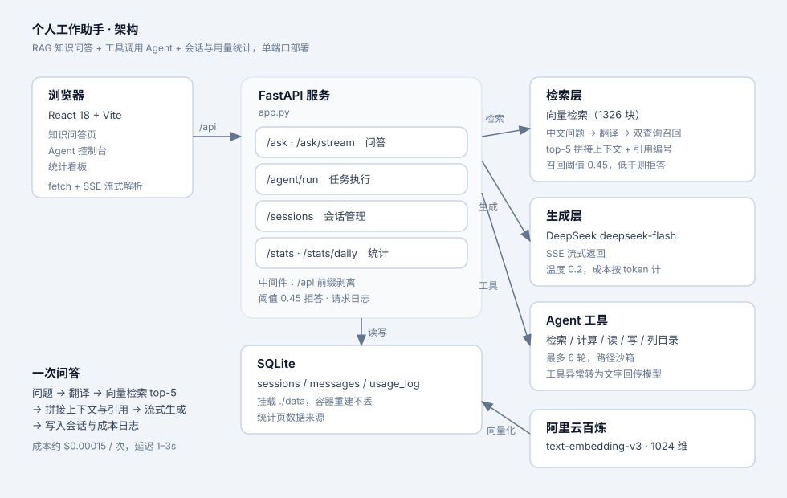

# 个人知识助手

基于 DeepSeek 的本地知识库问答与工具调用助手。支持带引用的文档问答、多步任务的 Agent、多会话记录和用量统计。



## 功能

- **文档问答**：向量检索 top-5 片段，模型依据片段回答并标注引用编号；没有相关资料时拒答
- **流式输出**：SSE 逐字返回，前端边收边显示
- **Agent**：5 个工具（检索、四则运算、读文件、写文件、列目录），模型自行决定调用顺序，最多 6 步
- **会话管理**：新建、切换、删除会话，历史消息持久化
- **用量统计**：问答次数、token、成本、平均延迟，按天聚合
- **MCP Server**：把检索与计算封装为 MCP 工具，Claude Desktop / Cursor 等客户端可直接调用

## 知识库

当前索引的是 **FastAPI 官方文档**（`docs/en/docs`）：158 篇 Markdown，剔除变更日志、贡献指南等元信息后剩 138 个文件、1326 个块，向量文件约 14MB。

重建索引：

```powershell
python ingest_docs.py --dry-run   # 先看切块数量
python ingest_docs.py             # 调用 embedding 生成 vectors.json
```

脚本会处理 frontmatter、`{!...!}` 引用、`///` 指令和代码块；支持断点续传，超过 8192 token 的块会被跳过。

如果换成自己的文档，把 Markdown 放进 `build/docs/`，用 `python step8_embed.py` 重建即可（那套脚本按字符切块）。

## MCP

项目提供 MCP Server（`build/mcp_server.py`），暴露两个工具：

| 工具 | 说明 |
|---|---|
| `search_docs` | 在 FastAPI 文档库中检索，返回段落与来源文件 |
| `calculator` | 四则运算与乘方，表达式用 AST 白名单校验 |

在支持 MCP 的客户端（Claude Desktop、Cursor 等）中配置：

```json
{
  "mcpServers": {
    "fastapi-docs": {
      "command": "python",
      "args": ["C:/path/to/ai-journey/build/mcp_server.py"]
    }
  }
}
```

命令行验证：`python mcp_client_demo.py`（列出工具并各调用一次）。

依赖：`pip install mcp`。MCP 服务端单独运行，不影响主应用镜像。

## 技术栈

| 层 | 选型 |
|---|---|
| 后端 | Python 3.11、FastAPI、SQLite |
| 前端 | React 18、Vite |
| 生成模型 | DeepSeek `deepseek-flash` |
| 向量模型 | 阿里云百炼 `text-embedding-v3`（1024 维） |

## 目录结构

```
build/
├── app.py               FastAPI 应用（问答 / Agent / 会话 / 统计）
├── llm.py               模型调用与成本计算
├── store.py             SQLite 存储层
├── step1_load_docs.py   读取文档
├── step2_chunks.py      文本切块
├── step3_retrieve.py    关键词检索
├── step8_embed.py       生成向量索引
├── step9_vector.py      向量检索
├── step13_agent.py      Agent 循环与工具定义
├── step14_task_eval.py  Agent 任务评测
├── mcp_server.py        MCP 服务（search_docs / calculator）
├── mcp_client_demo.py   MCP 客户端测试
├── test_safety.py       路径安全单元测试
├── docs/                知识库文档
├── eval/                评测集
├── vectors.json         向量索引
└── assistant.db         会话与成本数据（不入库）

frontend/
├── src/api.js           接口封装
├── src/views/           问答 / Agent / 统计 三个页面
└── vite.config.js       开发代理配置
```

## 快速开始

### 环境要求

- Python 3.10+
- Node.js 18+

### 配置

在仓库根目录创建 `.env`：

```ini
LLM_BASE_URL=https://api.deepseek.com
LLM_API_KEY=sk-xxx
LLM_MODEL=deepseek-flash
PRICE_IN=0.15
PRICE_OUT=0.6

BAILIAN_API_KEY=sk-xxx
BAILIAN_BASE_URL=https://dashscope.aliyuncs.com/compatible-mode/v1
EMBED_MODEL=text-embedding-v3
```

### 启动

方式一：一键启动（会自动构建前端并托管，单端口）

```powershell
powershell -ExecutionPolicy Bypass -File .\start.ps1
```

访问 http://127.0.0.1:8000，接口文档 http://127.0.0.1:8000/docs。

方式二：Docker

```powershell
docker compose up -d --build    # 构建并后台启动
docker compose logs -f          # 查看日志
docker compose down             # 停止
```

镜像为多阶段构建：Node 编译前端 → Python 运行时托管 API 和静态页面。
数据库和 Agent 生成的文件挂载在 `./data`，删除容器不会丢数据；`.env` 通过 `env_file` 注入，不打包进镜像。

国内网络拉取基础镜像较慢，可在 Docker Desktop → Settings → Docker Engine 中配置 `registry-mirrors`。

方式三：开发模式（前后端分离，支持热更新）

```powershell
# 终端 1
cd build
python app.py

# 终端 2
cd frontend
npm install
npm run dev
```

访问 http://localhost:5173，`/api` 由 Vite 代理到 8000。

### 重建索引

FastAPI 文档：`python ingest_docs.py`（见上文「知识库」）。

`build/docs/` 下的自有文档：

```powershell
python step8_embed.py
```

## API

| 方法 | 路径 | 说明 |
|---|---|---|
| POST | `/ask` | 问答，可带 `session_id` |
| POST | `/ask/stream` | 流式问答（SSE） |
| POST | `/agent/run` | 执行 Agent 任务 |
| POST | `/sessions` | 新建会话 |
| GET | `/sessions` | 会话列表 |
| GET | `/sessions/{id}` | 会话消息 |
| DELETE | `/sessions/{id}` | 删除会话 |
| GET | `/stats` | 汇总统计 |
| GET | `/stats/daily?days=7` | 按天统计 |
| GET | `/health` | 健康检查 |

前端请求统一带 `/api` 前缀，后端中间件负责剥离；开发环境由 Vite 代理，生产环境由同一服务处理。

## 评测

早期的检索对比实验在 3 篇示例文档上完成（共 9 块，评测集 20 题，存档于 `eval/legacy_demo/`）：

| 检索方式 | 阈值 | top-k | 准确率 |
|---|---|---|---|
| 关键词 | 0.1 | 3 | 70% |
| 关键词 + 查询改写 | 0.1 | 3 | 75% |
| 向量 | 0.45 | 3 | 80% |
| 向量 | 0.45 | 5 | 90% |

换成 FastAPI 文档后的检索评测（20 题，每题标注应命中的源文件，`python eval_retrieval.py`）：

| 方案 | recall@1 | recall@5 | 检索耗时 |
|---|---|---|---|
| 向量检索 | 85% | 95% | 0.65s |
| 向量 + 中文问题翻译成英文 | 75% | **100%** | 2.2s |

翻译会降低 top-1 精度，但产品把 top-5 交给模型挑选，所以按 recall@5 取舍：**中文提问走翻译，英文提问直接检索**（代码里按是否包含汉字判断）。

答案质量评测（20 题：15 可答 + 5 应拒答，`eval/questions_answer.json`，生成温度 0，连续跑 5 次）：

| 指标 | 结果 |
|---|---|
| 总准确率 | **84%**（5 次为 16–18/20，有波动） |
| 可答正确 | 79% |
| 拒答正确 | 5/5（稳定） |
| 平均耗时 / 单题成本 | 1.1s / 约 $0.00015 |

温度 0 也无法完全消除波动，端到端评测需多次取均值。

未通过的题集中在“需要成段示例代码”的问题（`Path(gt=0)`、`HTTPException` 用法、JWT 流程）。试过两种补救方案，均无提升：

- 索引保留代码块：准确率降到 75%
- 讲解块/代码块双路索引：80%，且 token 增加

代码块虽然能被检索到，但会挤占讲解文字的位置，模型拿到的上下文反而更差。

## 已知限制

- 向量检索是纯 Python 逐条计算余弦相似度，1300 块时单次约 0.6 秒；上万块需要专用向量库
- 向量索引是 14MB 的 JSON，启动时整体加载进内存
- 中文提问会多一次翻译调用，检索耗时增加约 1.5 秒
- 只索引了英文文档，中文文档需要另建索引
- SQLite 单机存储，不支持多实例部署
- Agent 每次任务独立，不带会话记忆
- 未实现鉴权，仅供本机使用
- 模型与向量调用为同步阻塞，并发依赖线程池

## License

MIT
